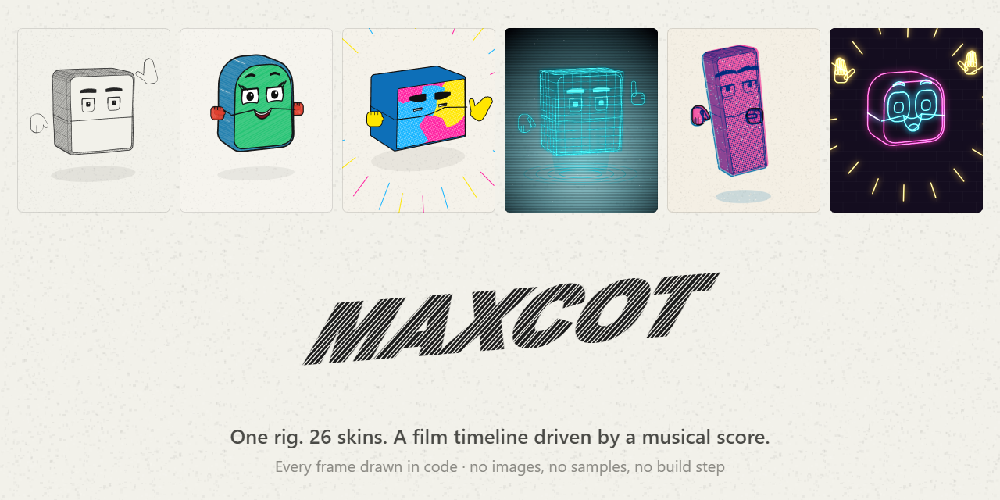

# Maxcot

**A character animation studio drawn entirely in code.** One rig, 43 visual skins, 8
actors and a film timeline, all driven by a score you write in bars and beats.

**[▶ Open the live studio](https://shibli21.github.io/maxcot/)** · [all 43 skins](https://shibli21.github.io/maxcot/sheet.html?mode=skins) · [smallest example](https://shibli21.github.io/maxcot/example.html)




No images, no sprites, no audio samples. Every line, hatch, halftone dot and glitch is
generated each frame on a `<canvas>`, and the soundtrack is synthesized with WebAudio.

This repository has two parts:

- **[`packages/maxcot`](packages/maxcot)**: the engine as an npm library (strict TypeScript, no runtime dependencies). It runs in the browser, in workers and in Node.
- **[`apps/studio`](apps/studio)**: the studio, a 64-second showcase that plays a score through every feature, with panels for playing with it yourself.

## Run the studio

```sh
git clone https://github.com/shibli21/maxcot.git
cd maxcot
bun install
bun run dev
```

- **Play the score** plays the showcase: poses, all 43 skins, every actor, the design dials, the film editor, multicam and four aspect ratios.
- **Open the studio** gives you the panels for free play: Styles, Tune, Poses, Design and Motion.
- Space plays and pauses, ← and → jump a bar, and the scrubber seeks anywhere. `g` toggles construction lines and Esc closes the panel.
- While it plays, the left side shows the score line that's running and the real source of whatever it touches.

## Use the engine

```ts
import { createCharacter } from 'maxcot';
import { pencil, hologram } from 'maxcot/skins';

const max = createCharacter(canvas, { skin: pencil, pose: 'wave' });
max.pose('feel-excited');
max.setSkin(hologram, 'cyan');
max.cast('oldman');
```

See the **[library README](packages/maxcot/README.md)** for scores, films, rendering in
Node and writing your own skin.

## The score

The whole showcase is one data file, [`apps/studio/src/scores/tour.score`](apps/studio/src/scores/tour.score):

```js
{
  title: 'Tour', bpm: 92,
  events: [
    { at: [2, 1], create: 'max' },
    { at: [3, 1], pose: 'thinking' },
    { at: [5, 2], style: 'felttip' },
    { at: [8, 1], style: 'hologram', palette: 'cyan' },
    { at: [17, 1], set: 'body.w', to: 1.05 },
    { at: [24, 2.5], end: { card: 'logo', text: 'MAXCOT' } },
  ]
}
```

**Edit it live.** The score pane in the studio is an editor: change a line and it plays
back immediately from where the playhead is. A syntax error is marked on its line, and the
last good version keeps playing. A typo such as `pose: 'thinkin'` gets a warning with a
suggestion. **Revert** goes back to the tour. Scores are plain data, parsed and never run,
so a score from someone else is safe to open.

**Save, open and share.** **Save** downloads your project (the score plus any timeline
edits) as a `.maxcot.json` file, and **Open** loads one back. **Share** copies a link with the
whole project packed into it. Nothing is uploaded; the project lives in the part of the URL
after `#`, which browsers never send to a server, so a full tour fits in about 2 KB. Unsaved
edits are kept as a local draft and come back after a reload. Files and links are read as data and
checked field by field, so opening one from someone else can't run code.

**More than one actor.** `enter` brings someone on stage, `on:` says who a command is for,
`look` turns one actor toward another, and `shot` moves the camera:

```js
{ at: [2, 1], enter: { id: 'kid', who: 'child' } },
{ at: [2, 2], look: 'max', on: 'kid' },
{ at: [3, 1], shot: 'close', on: 'kid' },
{ at: [5, 1], shot: 'wide' },
```

Open **Demos → Ensemble** in the studio to see a three-actor scene. Click an actor to make
the panels edit it. Each actor also has a **manner** (how heavy it is, its idle habit, where
its eyes wander, its rest pose), shown in the Motion panel and set from a score with
`{ manner: { weight: 0.2, idle: 'bouncy' }, on: 'boss' }`.

Characters can **talk**. `{ at: [2, 1], talk: 2, on: 'gran' }` babbles for two seconds in that
actor's own voice, and the mouth follows the sound (**Demos → Small talk**). The **Voice** tab
lip-syncs the selected actor to your microphone, an audio file or a test voice. The sound is
analysed on the page and never recorded or sent anywhere.

There are **sound effects** too: `{ at: [2, 1], sfx: 'boing' }` (pop, boing, whoosh, ding, thud,
zap, blip, slide, tada, crash), all synthesised in code. The film has its own **Sound** row on the
timeline (`edit: 'Sound'`) with effects and spoken lines you can drag, swap, add and delete
(**Demos → Sound check**). A recorded video carries all of it: the beat, every line and every effect.

The **Puppet** tab lets you play the selected actor live: the mouse steers where they look, holding
the button makes them talk, keys 1-9 strike poses (W hops, A and D step), and a gamepad works too.
Tick **Record** and press play: the poses you strike are written into the score at the beats you hit.

Each verb (`create`, `enter`, `exit`, `shot`, `look`, `style`, `pose`, `who`, `set`, `talk`, `sfx`, `play`, `camera`, `end` and the rest) is
one function in the studio's `CMD` table, and the UI calls the same functions, so anything
the score can do, you can do by hand.

## How it works

**A skin never sees 3D.** The rig poses an actor and the scene builder flattens it into
`S.parts`: polygons and lines tagged with a role, fill, shade, group and clip. The body is
a rounded, tapered box, extruded and projected, with back-face culling and shaded facets.
The face is mapped onto the front plane. A skin only decides how to paint those parts,
which is why one rig can be shown in 26 skins, and most skins are a short recipe on a
shared toon renderer.

**Poses are layered and sprung.** A pose sets channel targets on one layer (`all`, `face`,
`eyes`, `mouth`, `hands`, `body`) and is composed from small libraries of body moves,
expressions, mouths and hand shapes. Every channel springs toward its target, so any pose
can follow any other.

**Seeking replays the score.** A seek resets the studio and replays every earlier event
instantly, so the state at any moment is exactly what the score says.

```
packages/maxcot/src/
  types.ts           the scene contract shared by rig, scene builder and skins
  kit.ts             seeded noise, sketch/hatch/halftone/brush, the toon renderer, canvas factory
  design.ts          DESIGN (one row per dial) and CAST (actors as overrides)
  rig.ts             channels, layers, pose libraries, the spring-driven Actor
  character.ts       Actor → Scene, render(), the Character class
  stage.ts           a cast on one canvas: shared camera, looks, merged scenes
  skins/             26 skins in 5 groups
  film/film.ts       film Player and timeline Editor
  score/conductor.ts bars-and-beats sequencer with seek-by-replay
apps/studio/src/
  main.ts            views, panels, code panes, transport, the CMD table
  scores/*.score     the demos (tour, ensemble), as data
  hello.ts           the 13-second film
  beat.ts            the WebAudio drum machine
```

## The skins


| Group | Skins |
|---|---|
| Drawn | pencil, sketch, ballpoint, felt-tip, ink bleed, ink punch, gloss |
| Print and paste | CMYK print, riso, gig poster, spray stencil, manga, cubist collage |
| Screens and light | hologram (8 beams), vector wireframe, neon, oscilloscope, teletext, pixel sprite, afterglow |
| Glitch: signal | glitch, datamosh, databend, video feedback |
| Glitch: time | window trails, pixel wind, style mosh |
| House | maxcot (the house sticker), chalkboard, paper cut-out, crayon |
| Comics | Ben-Day, silver age, noir, webcomic |
| Cartoon | rubber hose, flat vector, claymation, anime cel |
| Pixels | Game Boy, 8-bit, isometric, ASCII |

Neon, oscilloscope, hologram, glitch and afterglow also run a WebGL **effects layer** (bloom, chroma,
glitch, feedback) after they draw, with a Canvas 2D stand-in where WebGL is missing; switch it off in
the Tune panel. The picture above shows the first 26; open the [skins sheet](https://shibli21.github.io/maxcot/sheet.html?mode=skins)
for all of them, or **Demos → New looks** in the studio.

## Development

```sh
bun run dev         # the studio, served by Vite from the library's TypeScript sources
bun run typecheck   # strict TypeScript, library and studio
bun run test        # library unit tests (incl. every skin in Node), then studio visual tests
bun run build       # the studio, for static hosting
bun run build:lib   # the library, to packages/maxcot/dist
```

- **Unit tests** (Vitest): poses, springs, the conductor, scene geometry, the published entry points, and every skin rendered in Node.
- **Visual tests** (Playwright): screenshots of every skin, pose and actor, plus four studio states rendered frame by frame. They use the Chrome already on your machine. Baselines are per platform; run `bun --filter @maxcot/studio test:update` to record yours.

## Rendering a video

**In the browser:** press **Export** in the studio for an MP4 (with the soundtrack), an animated
GIF or a PNG still. It is made in the page with WebCodecs, stepping the studio one exact frame at a
time, so nothing is dropped and nothing is uploaded. Pick the range, shape (16:9, 9:16, 1:1, 4:5),
size (up to 1440p) and frame rate. MP4 needs a browser with WebCodecs (Chrome, Edge, recent Safari);
GIF and PNG work everywhere.

**From the command line:** `?capture` turns off the studio's real-time clock so it can be stepped one frame at a
time. The recorder drives it in headless Chrome and pipes the frames into ffmpeg. The studio
logs every line, effect and film sound as it plays, so the soundtrack (the beat rendered
offline with all of those mixed on top) is muxed in afterwards:

```sh
bun run record                                   # out/maxcot.mp4, 1920×1080, 30 fps
bun run record --start=17 --end=24 --out=out/clip.mp4
```

It needs Chrome or Edge (or `--chrome=/path`) and `ffmpeg` on your PATH. The social
preview is drawn by `apps/studio/poster.html`.

## License

[MIT](LICENSE)
