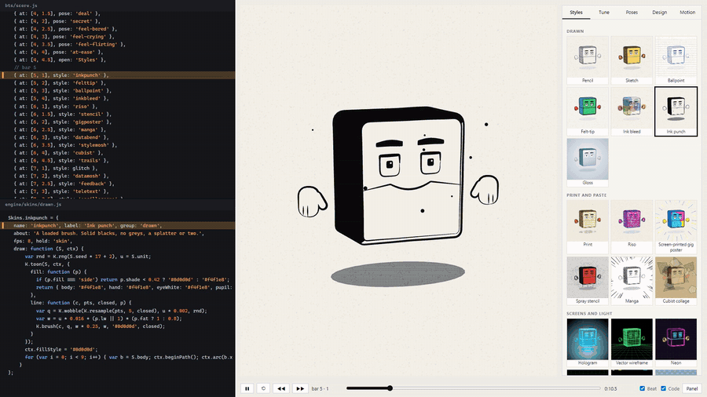
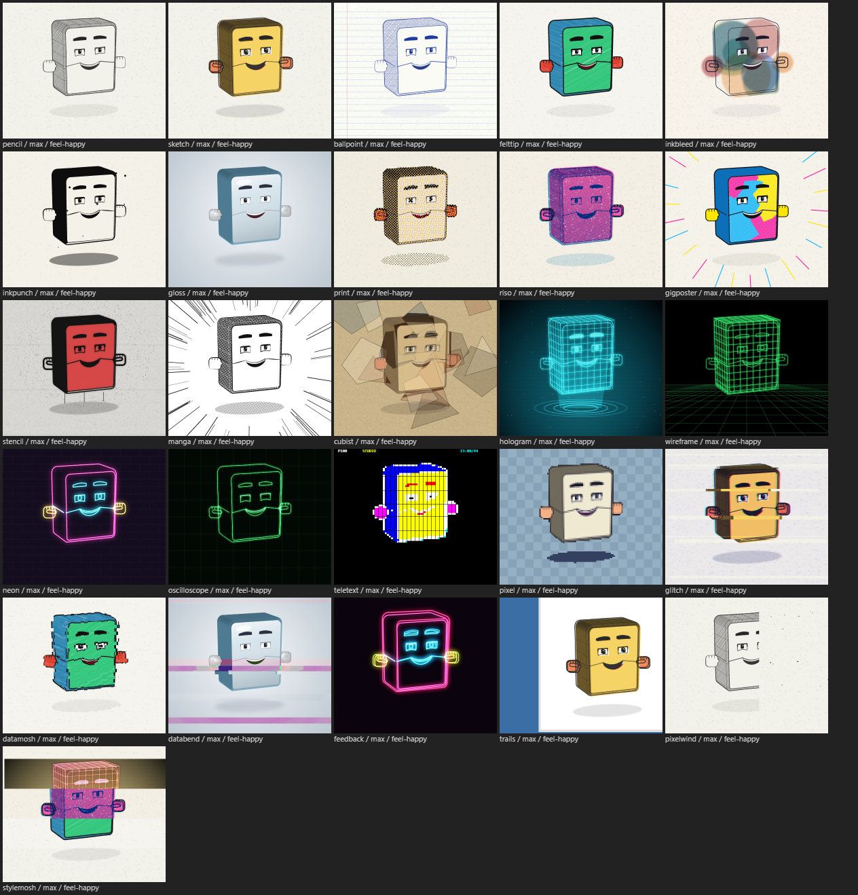

# Maxcot

**A character animation studio drawn entirely in code.** One rig, 26 visual skins, 8
actors and a film timeline, all driven by a score you write in bars and beats.




No images, no sprites, no audio samples, no build step. Every line, hatch, halftone
dot and glitch is generated each frame on a `<canvas>`, and the soundtrack is
synthesized live with WebAudio.

## Try it

Clone the repository and open `studio.html` in Chrome or Edge (tested there; other modern browsers should work). That's all.

```sh
git clone https://github.com/shibli21/maxcot.git
cd maxcot
# then open studio.html, or serve it:
bunx serve .
```

- **Play the score** plays the 64-second showcase: every pose, every skin, every actor and the film editor.
- **Open the studio** gives you the panels for free play: Styles, Tune, Poses, Design and Motion.
- Space plays and pauses, ← and → jump a bar, and the scrubber seeks anywhere (exactly: the
  studio is rebuilt by replaying the score up to that point). `g` toggles
  construction lines and Esc closes the panel.

## The score

The whole showcase is one data file, `bts/score.js`. Each line is a beat and a command:

```js
{ at: [2, 1], create: max },
{ at: [3, 1], pose: 'thinking' },
{ at: [5, 2], style: 'felttip' },
{ at: [8, 1], style: 'hologram', palette: 'cyan' },
{ at: [9, 2], who: 'girl' },
{ at: [17, 1], set: 'body.w', to: 1.05 },
{ at: [20, 1], play: 'filmkit/films/hello.js' },
{ at: [24, 2.5], end: { card: 'logo', text: 'MAXCOT' } }
```

The verbs are `create`, `style`, `look`, `open`, `pose`, `who`, `set`, `preset`, `size`, `sizes`,
`sheet`/`grid`, `deal`, `faces`, `edit`, `play`, `camera`, `take` and `end`. Each one maps to a
single function in `studio.js` (`CMD`), and the UI calls those same functions, so anything
the score can do, you can do by hand.

## How it works

```
bts/score.js         the showcase as data: { at: [bar, beat], <command>: value }
bts/bts.js           conductor: bars → seconds, fires commands, seek = replay
bts/audio.js         WebAudio kick/clap/hats/bass/stab; offline render for export
engine/design.js     DESIGN: one row per dial (the Design panel is built from it), CAST: actors
engine/rig.js        channels, layers and pose libraries; a spring-driven Actor
engine/character.js  rig state → flat Scene: extruded box, culled + shaded facets, face, mitts
engine/kit.js        seeded noise, sketch/hatch/halftone/brush, and the shared toon renderer
engine/skins/*.js    26 skins in 5 groups
filmkit/film.js      film Player (shots, beats, who/style tracks, cameras) + timeline Editor
studio.js            views, panels, code panes, transport
```

**The one idea:** a skin never sees 3D. `character.js` flattens the posed actor into
`S.parts`, a list of polygons and lines, each tagged with a `role`, `fill`, `shade`,
`group` and `clip`. A skin only decides how to paint them. That is why one rig can be
shown in 26 skins, and most skins are a short recipe on top of `K.toon(...)`.

**Poses are layered.** A pose sets channel targets on one layer (`all`, `face`, `eyes`,
`mouth`, `hands`, `body`) and is composed from small libraries:

```js
feel('crying', ['bow', 'eyes-shut-tight', 'mouth-wobble'], { 'fx.tears': 1 });
```

Every channel springs toward its target, so any pose can follow any other without hand-drawn in-betweens.

## The skins



| Group | Skins |
|---|---|
| Drawn | pencil, sketch, ballpoint, felt-tip, ink bleed, ink punch, gloss |
| Print and paste | CMYK print, riso, gig poster, spray stencil, manga, cubist collage |
| Screens and light | hologram (8 beams), vector wireframe, neon, oscilloscope, teletext, pixel sprite |
| Glitch: signal | glitch, datamosh, databend, video feedback |
| Glitch: time | window trails, pixel wind, style mosh |

## Extending

- **A skin:** `Skins.myskin = { name, label, group, fps, ground, draw(S, ctx, view) }` in any file under `engine/skins/`.
- **A pose:** `add('attitudes', 'name', { layer: 'all', mix: ['lean-in', 'happy', 'mouth-smile', 'h:point'] })` in `engine/rig.js`.
- **An actor:** `cast('key', 'Label', 'about', { 'body.w': 1.2, 'eyes.size': 0.2 })` in `engine/design.js`.
- **A score verb:** add it to `CMD` in `studio.js` and use it in `bts/score.js`.
- **Checking it:** open `test.html?mode=skins`, `?mode=poses` or `?mode=cast` for contact sheets.

## Rendering a video

`studio.html?capture` turns off the real-time clock so the studio can be stepped one frame
at a time. `tools/record.mjs` drives it in headless Chrome and pipes the frames, plus the
beat rendered offline, into ffmpeg:

```sh
bun install
bun tools/record.mjs                                   # out/maxcot.mp4, 1920×1080, 30 fps
bun tools/record.mjs --start=17 --end=24 --out=out/clip.mp4
```

It needs Chrome or Edge (or `--chrome=/path`) and `ffmpeg` on your PATH. The social preview
in `media/` is drawn by `tools/poster.html`.

## License

[MIT](LICENSE)
